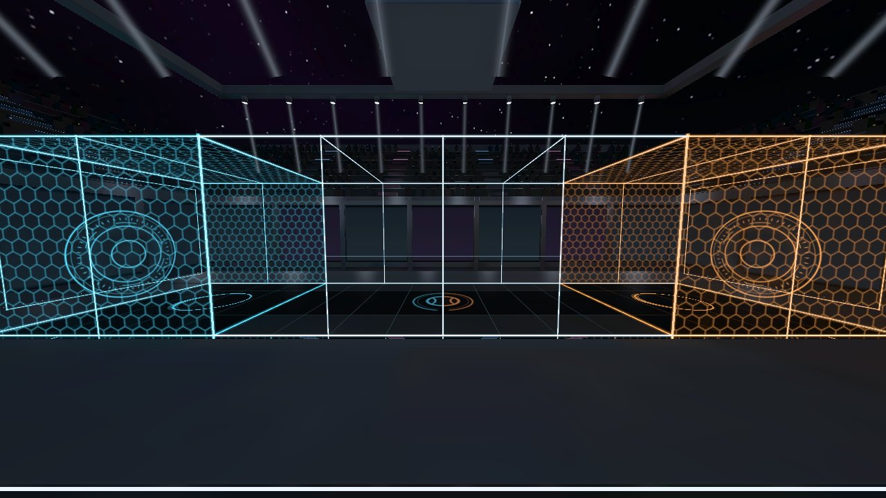
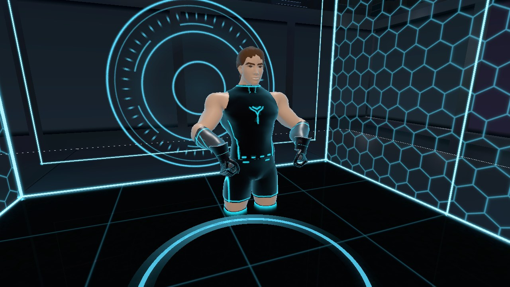
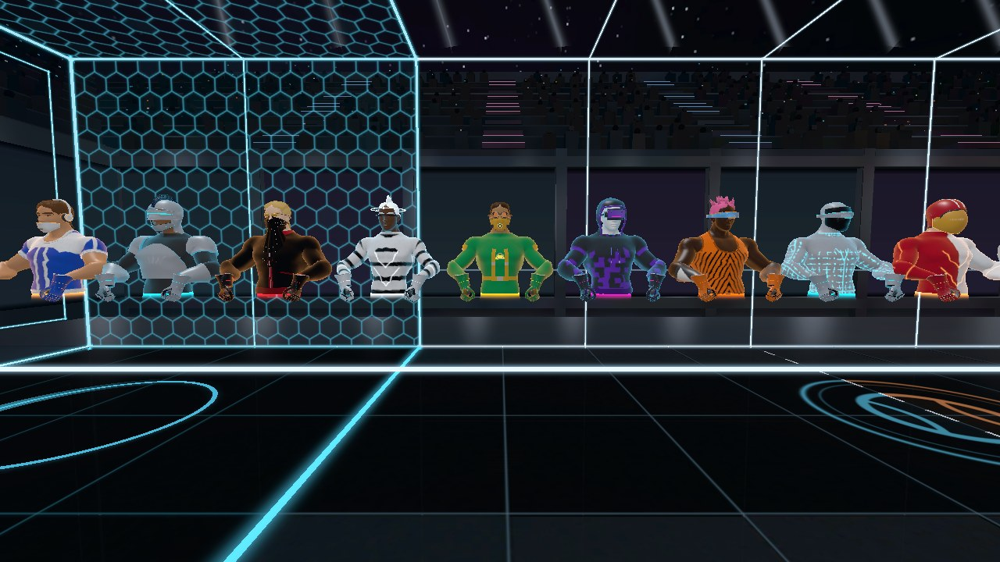
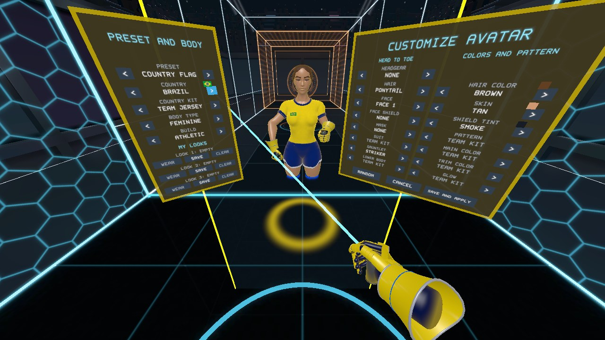
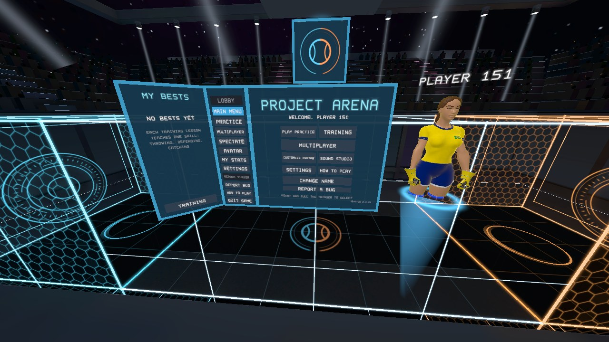
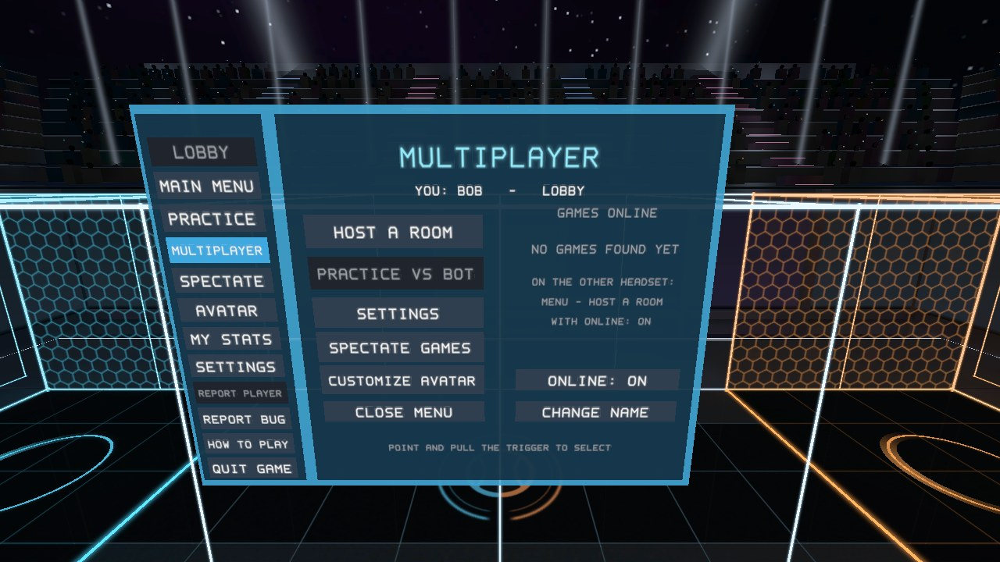
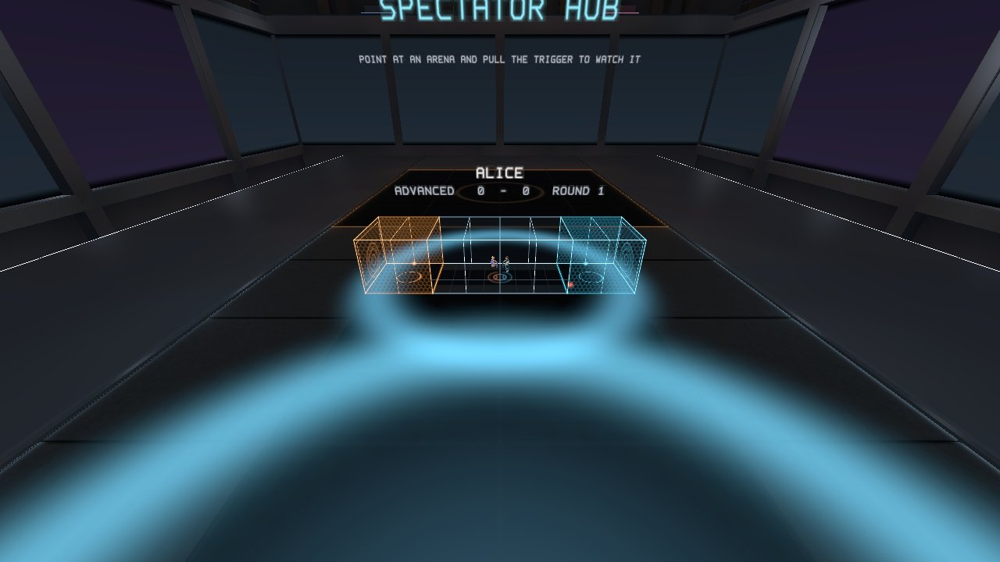
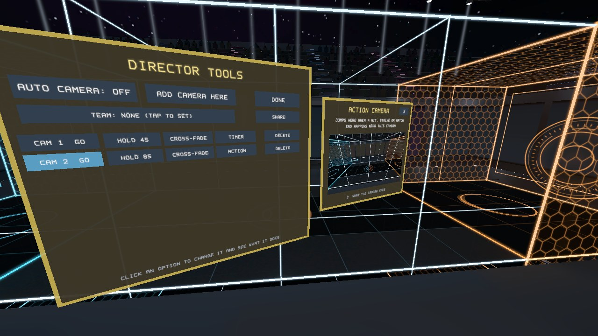
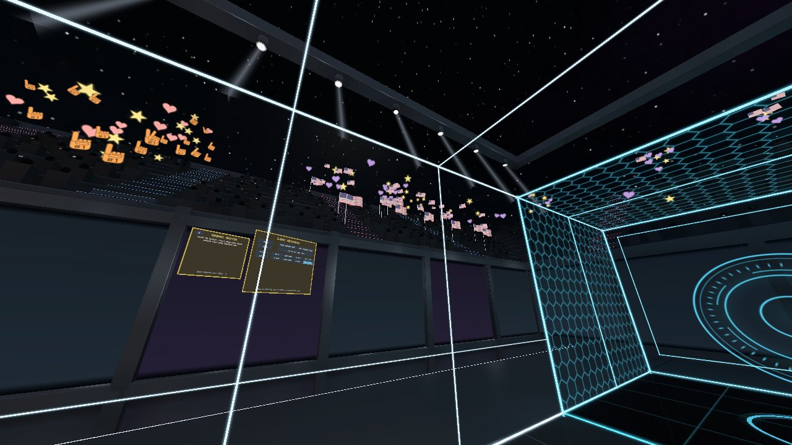
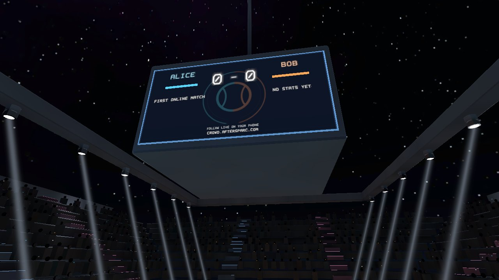

# Project Arena for Unity

**Not the official Project Arena: a starting point for your own version.**

**Just want to play?** Get the official game: [on Meta Quest](https://www.meta.com/experiences/1342896058915258/),
or the Quest APK and PC VR builds from [Project Arena's releases](https://github.com/jendoebelin/ProjectArena-public/releases/latest)
([how to install](https://github.com/jendoebelin/ProjectArena-public/blob/main/docs/INSTALL.md)). This repository has
no builds to download: it's the game's source in Unity, for making your own version or seeing how it works.

A free, open-source VR court sport for **Meta Quest** and **PC VR**, built in **Unity**. Two players face each other in a
glass arena and throw, curve, catch and punch glowing energy balls. Hit your opponent to score; a charged ball raises
your shield; send a ball through their ring for a strike.

The official game is [Project Arena](https://github.com/jendoebelin/ProjectArena-public), a native C++ game (OpenXR, no
engine). This repository is the same game rebuilt in Unity, open for you to
fork and make your own. Your version can be anything you like. **As long as the ball physics and the arena rules stay
compatible, it can still connect to Project Arena players and play against them**: the network protocol is the same,
so your headset and theirs meet in the same arena rooms, on the LAN or on the community server.

| | |
|---|---|
|  |  |
| **Your avatar:** suits, builds, faces, hair that moves, headgear, face shields, masks, gauntlets, patterns and colours, or your country's team kit | **Countries:** 205 flags; a country's kit, its flag on your back and its colours on your end of the court |
|  |  |
| **The avatar builder:** a mirror that copies you, a panel on each side | **The title menu** in the lobby: your TRAINING bests on its left, your avatar beside it |
|  |  |
| **Multiplayer:** host a room or join one; queue for the tank; voice chat | **Spectating:** every live arena in miniature; point at one to watch it |
|  |  |
| **Director tools:** fly around, save cameras, let the auto camera cut between them, share them with your team | **The Crowd:** fans following on their phones wave flags and cheer in the stands |

*(Pictures rendered in the Unity editor from the game's own open art.)*

## Make it your own

Fork this repository and build your own version of the game. The idea is to **make something new and share it**,
not to publish another copy of the same game. Everything here is yours to change:

- **The look:** new arenas, art, outfits and sounds.
- **The modes:** teams, training drills, a single-player game.
- **The menus and the lobby.**
- **Tools:** for VR teachers, coaches or streamers.
- **Anything else** we haven't thought of.

**Playing against Project Arena players.** Your version can join the same rooms as long as it stays compatible with
the game:

- **The ball physics** (`Assets/ProjectArena/Sim`): speeds, curve, bounces, catching, shields, knuckle guards and
  strikes.
- **The arena rules:** the court, scoring, the rounds and MATCH OPTIONS.
- **The network protocol** (`Assets/ProjectArena/Net`): the same packets.

The host of a room runs the match, so everyone in it plays by the host's rules. Change the physics or the rules and
your game becomes something new: run it on your own server (`server/projectarena_relay.py` in the native repository)
rather than mixing it into Project Arena rooms. We are working on a check that marks matches with different rules.

Give your version its own name. Please don't present it as the official Project Arena. Then tell us about it
([Discord](https://discord.gg/KuNkSbVHzh) or vrsportsfan@gmail.com).

## What's in it

- **Play the bot:** practice against bots in the room you choose (SQUARE, DIAMOND, FOUR CORNERS for four players,
  FIREBALL BLITZ), with its options: shields on or off (HOTDOG MODE), knuckle guards, the time, the foul line and more.
- **TRAINING:** lessons that each teach one skill (throwing, defending, catching); MY BESTS keeps your bests.
- **The lobby:** a balcony over the court with the menu, your TRAINING bests and your avatar beside it, and two bots playing below.
- **Avatars and the builder** (pictures above).
- **Multiplayer:**
  - **Rooms:** host one or join one, on the LAN or the community server. You start in the waiting area outside the
    tank, then JOIN QUEUE; players take turns after each match, and the bot fills an empty place.
  - **Talking and safety:** voice chat (push to talk or open mic, with mutes), REPORT PLAYER, vote to remove, and the
    host's kick.
- **Career statistics on the server:** MY STATS, with DELETE MY STATS.
- **Spectating:** the hub of live arenas, the gallery seat, and the director tools.
- **The Crowd:** fans following on their phones wave flags in the stands, and the arena's lights flare when they cheer.
- **REPORT A BUG** from inside the game.

## Where things are

| | |
|---|---|
| `Assets/ProjectArena/Sim` | the ball physics and the rules in plain C# (keep these compatible to play with Project Arena) |
| `Assets/ProjectArena/Net` | the network protocol (keep this compatible too) |
| `Assets/ProjectArena/Avatar` | avatar options, countries, presets and the body rig |
| `Assets/ProjectArena/Runtime` | the game in Unity: headset input, drawing, menus, lobby, rooms, spectating, voice, sound |
| `Assets/ProjectArena/Art/Open` | the open art and sound |

## Licences and credits

- **Code:** MIT, see [LICENSE](LICENSE).
- **Art and sound** (`Assets/ProjectArena/Art/Open`): CC BY 4.0, see [LICENSE-ASSETS.md](LICENSE-ASSETS.md). Credit
  "Project Arena" if you use or adapt them.
- **Avatar bodies and heads:** derived from Quaternius's Universal Base Characters pack (CC0), retargeted for Project
  Arena.
- **No CCP assets:** this repository contains none from any CCP Games product. Project Arena is an
  independent game, not affiliated with or endorsed by CCP Games.

## Contact

[Discord](https://discord.gg/KuNkSbVHzh) · vrsportsfan@gmail.com
